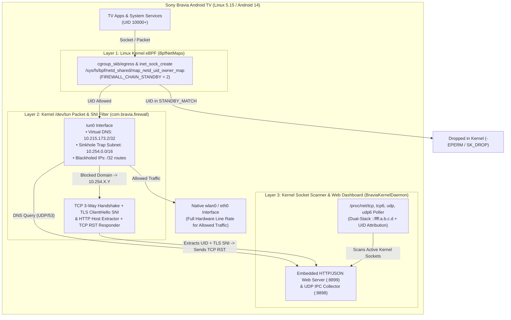

# Sony Bravia / Android TV — Hybrid Kernel Egress Application Firewall

A zero-root, kernel-level egress application firewall and real-time network monitor for **Sony Bravia Android TV (Android 14 / Linux 5.15+)**.

It combines **Linux Kernel eBPF socket filtering (`BpfNetMaps`)**, a **Kernel `/dev/tun` DNS Sinkhole & TLS `ClientHello` SNI Packet Inspector (`VpnService`)**, and a **High-Frequency `/proc/net` Kernel Socket Scanner** with an embedded **Real-Time Web Dashboard (`:8899`)**.

---

## Why This Exists

On Android TV devices, dozens of pre-installed system packages, telemetry daemons, Automatic Content Recognition (ACR) trackers, and voice/remote services hold permanent `INTERNET` permissions—and some receive microphone audio over non-standard channels (such as Bluetooth LE GATT `AB5E0003-5A21-4F05-BC7D-AF01F617B664` in `com.google.android.tv.remote.service` without even requesting `android.permission.RECORD_AUDIO`).

Traditional Android VPN firewalls that route `0.0.0.0/0` through a userspace proxy bottleneck 4K HDR streaming and can sever local LAN / Wireless ADB connections. Conversely, simple DNS blockers cannot stop apps that use hardcoded IPs, QUIC/UDP, or direct socket connections.

This firewall solves both problems using a **three-layer hybrid kernel architecture**:



---

## Core Architecture

### 1. Layer 1 — Linux Kernel eBPF Per-App Firewall (`BpfNetMaps`)
- Android 13/14's Linux 5.15 kernel attaches `netd` eBPF programs (`cgroup_skb/egress`, `cgroup_skb/ingress`) backed by `/sys/fs/bpf/netd_shared/map_netd_uid_owner_map`.
- Running as `uid=2000` (`com.android.shell`, which holds `NETWORK_SETTINGS` and `CONNECTIVITY_INTERNAL`), `BraviaKernelDaemon` invokes `IConnectivityManager.setFirewallChainEnabled(2, true)` and `setUidFirewallRule(2, uid, rule)` to program **`FIREWALL_CHAIN_STANDBY` (`STANDBY_MATCH`)** directly in the kernel.
- **Zero CPU Overhead & Unbypassable:** Any app UID placed in `STANDBY_MATCH` has 100% of its egress/ingress packets dropped inside the kernel before a packet can leave the socket—blocking hardcoded IPs, DNS-over-HTTPS (DoH), QUIC/UDP, and raw sockets alike.
- **Core UID Safety Guard:** Hardcoded protection prevents blocking `uid < 10000` (`root`, `system`, `bluetooth`, `network_stack`, `shell`) or `com.bravia.firewall`, guaranteeing that Wireless ADB and local LAN access are never interrupted.

### 2. Layer 2 — Kernel `/dev/tun` DNS Sinkhole, IP Blackhole & TLS SNI Inspector (`com.bravia.firewall`)
- Instead of routing `0.0.0.0/0` through userspace (which degrades high-bitrate 4K streaming), `BraviaTunVpnService` configures surgical kernel routes on `tun0`:
  - `10.215.173.2/32`: Virtual DNS server inside `/dev/tun` that intercepts all system and app DNS queries (`UDP/53`) and rejects opportunistic DNS-over-TLS (`TCP/853`) probes so apps cannot bypass inspection.
  - `10.254.0.0/16`: Virtual Sinkhole Trap subnet.
  - Dynamic `/32` routes for any explicitly blackholed external IPv4 addresses.
- **How Trap IPs + TLS SNI Inspection Work:**
  1. When an app queries a **blocked domain** (exact or wildcard `*.domain.com`), `/dev/tun` synthesizes a DNS `A` response pointing to a unique virtual trap IP `10.254.X.Y` (with a 5-second TTL).
  2. Milliseconds later, the calling app initiates a `TCP SYN` (or `UDP` packet) to `10.254.X.Y:443`.
  3. Because that socket is created directly by the calling app, `BraviaTunVpnService` calls `ConnectivityManager.getConnectionOwnerUid()` to identify the **exact Android App `UID`**.
  4. For port `443`/`80`, `BraviaTunVpnService` completes a synthetic local 3-way handshake (`SYN,ACK`) on `tun0`, reads the client's first payload packet (`TLS ClientHello` or HTTP request), parses TLS extension `0x0000` (`server_name` / SNI) or `Host:`, logs the verified `BLOCKED (TUN SNI)` event with the exact `UID`, and immediately terminates the connection with `TCP RST,ACK`.
  5. For **allowed domains**, `BraviaTunVpnService` resolves the query upstream, parses all returned `A`/`AAAA` records, and streams `IP -> Domain` mappings to `BraviaKernelDaemon` over local UDP IPC (`127.0.0.1:8898`).

### 3. Layer 3 — `/proc/net` Kernel Socket Scanner & Real-Time Web Dashboard (`:8899`)
- `BraviaKernelDaemon` polls `/proc/net/tcp`, `/proc/net/tcp6`, `/proc/net/udp`, and `/proc/net/udp6` every 300ms.
- Automatically normalizes Android's dual-stack IPv4-mapped IPv6 sockets (`::ffff:a.b.c.d` / `0000000000000000FFFF0000XXXXXXXX`) and correlates every active socket with:
  - The TV's installed package database (`UID -> Package Name(s)`).
  - The real-time `/dev/tun` DNS table (`Remote IP -> Domain Name`).
  - The live Kernel eBPF `BpfNetMaps` state (`ALLOWED` vs `BLOCKED`).
- Serves a self-contained, dependency-free **Real-Time Web Dashboard** on port `8899` (`http://<TV_LAN_IP>:8899` or `http://localhost:8899` via ADB port forwarding) featuring:
  - **Live Egress Connection Alerts** with 1-click **Block App (eBPF)**, **Block Domain (`/dev/tun`)**, **Block IP**, or **Dismiss**.
  - **Live Egress Stream** of all allowed and blocked connection attempts.
  - **Active Kernel Sockets (`/proc/net`)** viewer.
  - **Per-App Kernel eBPF Manager** to toggle `STANDBY_MATCH` in the kernel for any installed app.
  - **Domain & IP Rule Manager** supporting exact domains, wildcard domains (`*.example.com`), and `/32` IP blackholes.
  - **Live DNS Resolution Log**.

---

## Default Pre-Blocked Telemetry, Voice/Mic & ACR Rules

Out of the box, the firewall operates in **Default Allow + Pre-Block Telemetry/Mic/ACR** mode (customizable in the Web Dashboard and persisted to `/data/local/tmp/bravia_fw/rules.conf`):

### Pre-Blocked App UIDs (Linux Kernel eBPF `STANDBY_MATCH`)
| Package Name | Purpose / Reason Blocked |
| :--- | :--- |
| `com.google.android.tv.remote.service` | **BLE Remote Control Mic Service** (receives raw voice audio over BLE `AB5E0003` and holds `INTERNET` without `RECORD_AUDIO`) |
| `com.google.android.katniss` | **Google Assistant / Hotword** (voice capture & cloud upload) |
| `com.sony.dtv.voicesearch` | **Sony Voice Search** (built-in microphone recognition service) |
| `com.sony.dtv.seeds.iot` | **Sony SEEDS IoT Telemetry** (background telemetry uploader) |
| `com.sony.dtv.seeds.auth` | **Sony SEEDS Auth Telemetry** |
| `tv.samba.ssm` & `tv.samba.ssm.ui` | **Samba TV ACR** (Automatic Content Recognition screen tracking) |
| `com.android.adservices.api` | **Android AdServices** |
| `com.android.sdksandbox` | **Android Advertising SDK Sandbox** |
| `com.google.android.feedback` | **Google Feedback Telemetry** |
| `com.sony.dtv.customersupport` | **Sony Customer Support Telemetry** |

### Pre-Blocked Domains (`/dev/tun` DNS Sinkhole + TLS SNI Trap)
- **Sony Bravia Telemetry:** `ssm1.internet.sony.tv`, `ssm2.internet.sony.tv`, `ssm3.internet.sony.tv`, `*.ndmdhs.com`, `*.idd.sony.net`, `reg.biv.sony.tv`
- **Samba TV ACR:** `*.samba.tv`, `*.flingo.tv`, `*.sambaa.com`
- **Ads & Analytics:** `*.doubleclick.net`, `*.googleadservices.com`, `*.googlesyndication.com`, `*.app-measurement.com`, `*.google-analytics.com`

---

## Persistence Across Standby & Reboots

1. **Always-On VPN & Direct-Boot Receiver (`BootReceiver.java`):**
   - Configures `settings put secure always_on_vpn_app com.bravia.firewall`, grants `ACTIVATE_VPN` / `RUN_ANY_IN_BACKGROUND`, and whitelists `com.bravia.firewall` from Doze (`deviceidle`).
   - Mirrors all synced domain, IP, and UID rules into device-protected storage (`tun_rules.conf`) so `/dev/tun` filtering starts immediately on cold boot even before user unlock.
2. **OS `/data/system/netpolicy.xml` Mirroring:**
   - Every UID blocked in Kernel eBPF is also mirrored into Android's `INetworkPolicyManager` (`POLICY_REJECT_METERED_BACKGROUND`), which persists in `/data/system/netpolicy.xml` across reboots.
3. **Standby/Wake eBPF Self-Healing Loop:**
   - Every 3 seconds, `BraviaKernelDaemon` checks `IConnectivityManager.getFirewallChainEnabled(2)` and re-asserts `FIREWALL_CHAIN_STANDBY` and all blocked UIDs if Android TV's power manager toggles the chain during sleep/wake transitions.
4. **Optional Host Watchdog (`watchdog.sh`):**
   - Can be scheduled via `launchd` / `cron` on a LAN host to automatically re-verify and start `BraviaKernelDaemon` (`uid=2000`) if the TV loses wall power and cold-reboots.

---

## Repository Structure

```text
.
├── apk/
│   ├── AndroidManifest.xml                            # Direct-Boot aware VpnService & BootReceiver manifest
│   ├── res/values/strings.xml                         # App resources
│   └── src/com/bravia/firewall/
│       ├── BraviaTunVpnService.java                   # Kernel /dev/tun DNS sinkhole, IP blackhole & TLS SNI inspector
│       ├── BootReceiver.java                          # Starts /dev/tun service on BOOT_COMPLETED / LOCKED_BOOT_COMPLETED
│       └── MainActivity.java                          # Android TV Leanback status screen & auto-starter
├── daemon/
│   └── src/
│       ├── BraviaKernelDaemon.java                    # Privileged uid=2000 Kernel eBPF controller, /proc/net scanner & HTTP API
│       └── DashboardHtml.java                         # Embedded Real-Time Web Dashboard UI
├── build_and_deploy.sh                                # Zero-Gradle SDK build & one-command ADB deployment script
└── watchdog.sh                                        # Optional host watchdog for cold power cycles
```

---

## Prerequisites & Quick Start

### Requirements
- **Android SDK** (`platforms/android-34`, `build-tools/34.0.0+`, `platform-tools/adb`) installed at `$ANDROID_HOME` (or `~/Library/Android/sdk` on macOS).
- **JDK 17+** (`javac`, `keytool`).
- **Wireless Debugging (ADB)** enabled and paired on your Sony Bravia / Android TV.

### Build & Deploy in One Command
```bash
chmod +x build_and_deploy.sh
./build_and_deploy.sh
```

What `build_and_deploy.sh` does:
1. Compiles and signs `com.bravia.firewall` (`bravia-firewall.apk`) using `aapt2`, `javac`, `d8`, `zipalign`, and `apksigner`.
2. Compiles `BraviaKernelDaemon` into `bravia_daemon.dex`.
3. Installs the APK onto the connected TV, grants `ACTIVATE_VPN` / `RUN_ANY_IN_BACKGROUND`, and enables Android's Always-On VPN.
4. Extracts the TV's live `UID -> Package` map (`packages.tsv`) and pushes it with `bravia_daemon.dex` to `/data/local/tmp/bravia_fw/`.
5. Starts `BraviaKernelDaemon` (`uid=2000`) and `BraviaTunVpnService` (`/dev/tun`).
6. Forwards local port `8899` (`adb forward tcp:8899 tcp:8899`).

### Open the Web Dashboard
- **Local machine (via ADB forward):** `http://localhost:8899`
- **Any device on the same LAN:** `http://<TV_LAN_IP>:8899`

---

## REST API Reference (`:8899`)

| Endpoint | Method | Description |
| :--- | :--- | :--- |
| `/` | `GET` | Serves the Real-Time Web Dashboard UI |
| `/api/state` | `GET` | Returns full JSON state (eBPF status, `/dev/tun` status, alerts, events, active sockets, DNS log, apps) |
| `/api/tun-rules` | `GET` | Plaintext rule feed (`DOMAIN\|...`, `IP\|...`, `UID\|...`) consumed by `BraviaTunVpnService` |
| `/api/action` | `POST` | Form-encoded actions: `block_uid`, `allow_uid`, `block_domain`, `allow_domain`, `block_ip`, `allow_ip`, `dismiss_alert`, `clear_alerts` |
